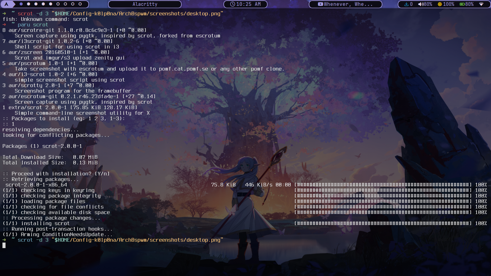
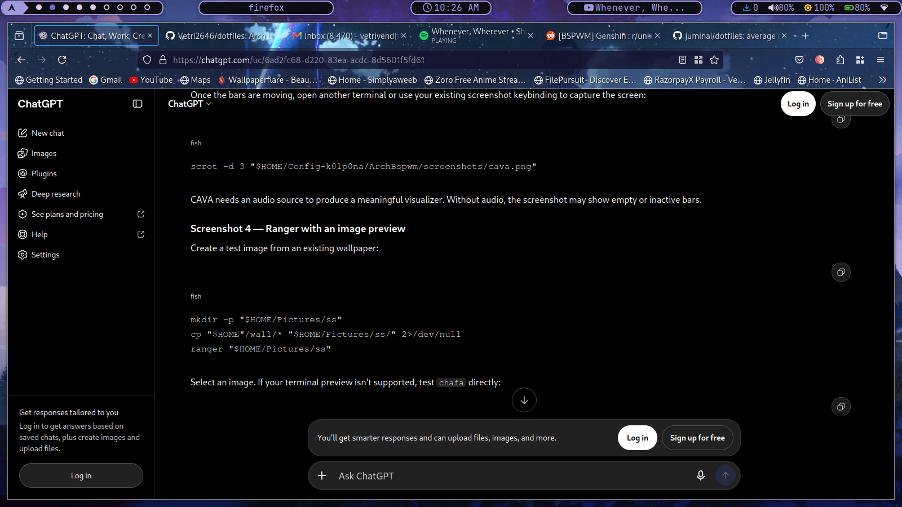
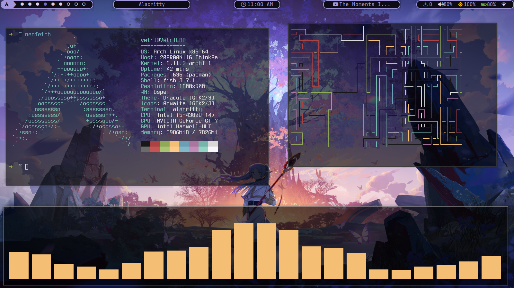
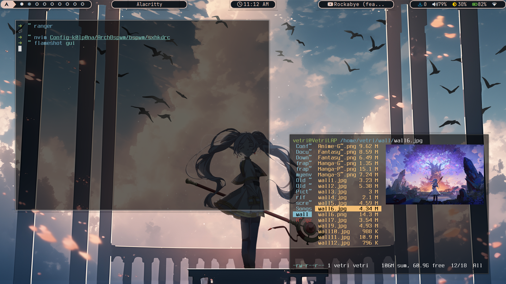
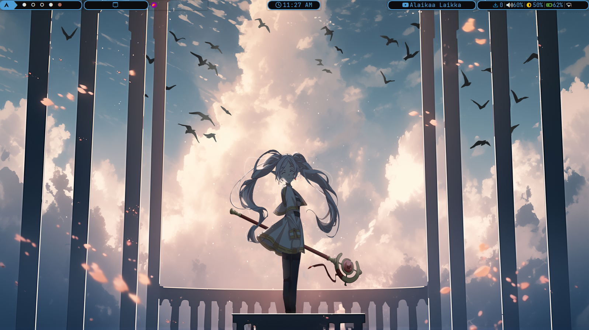
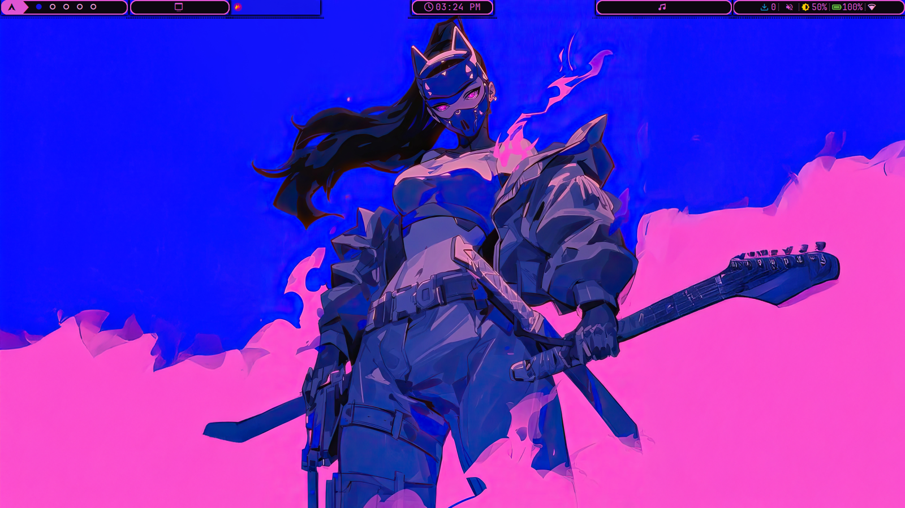
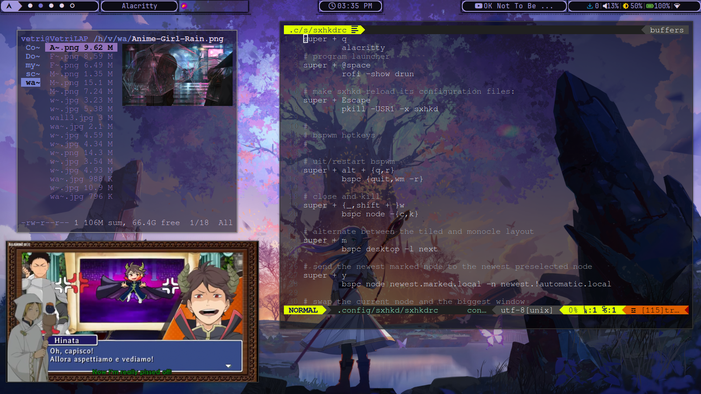
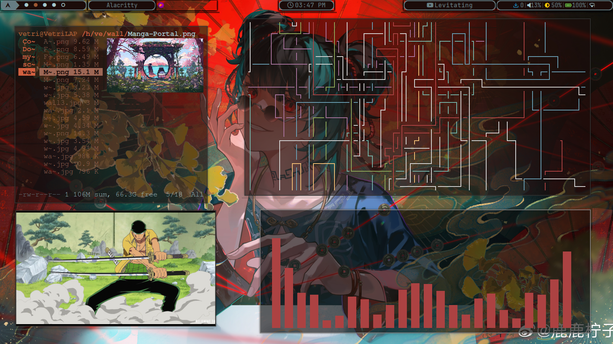
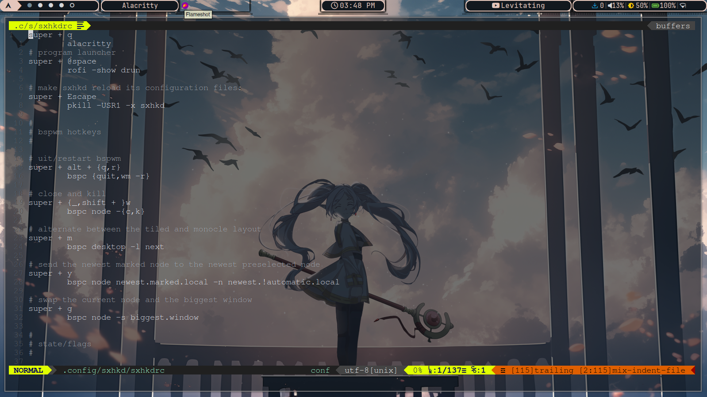
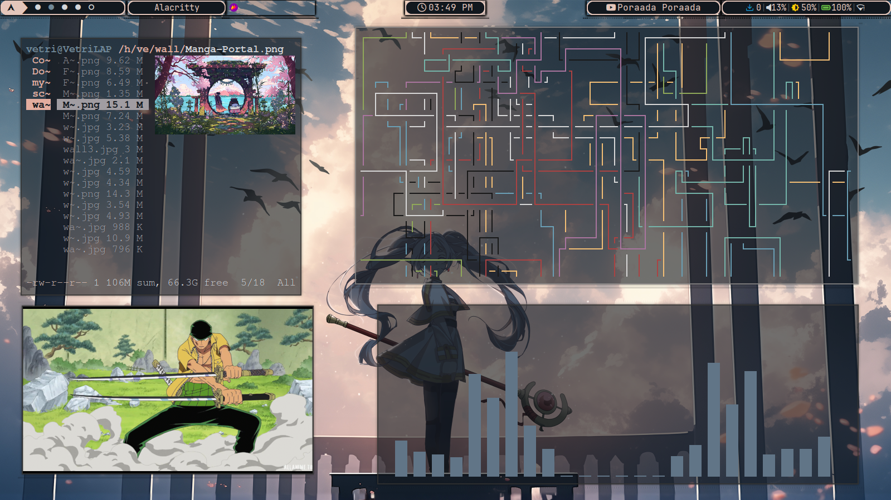

# Arch BSPWM Dotfiles

My personal Arch Linux setup using **BSPWM**, **SXHKD**, dynamic Pywal16 colors, Polybar, and Rofi.


## Screenshots 🖼️





















## Software

| Component | Software |
|---|---|
| Window manager | BSPWM |
| Keybindings | SXHKD |
| Terminal | Alacritty, Kitty |
| Bar | Polybar |
| Launcher | Rofi |
| File manager | Nemo, Yazi |
| Shell | Zsh |
| Browser | Brave, Firefox, Chromium |
| Music | Spotify, Amberol |
| Notifications | Dunst |
| Compositor | Picom |
| Lock screen | Betterlockscreen |
| Screenshots | Scrot, Flameshot |
| Text editors | Xed, Nano, Sublime Text |
| Colors | Pywal16 |
| Fonts | JetBrainsMono Nerd Font, Noto fonts |
| Display manager | SDDM with Sugar Candy |
| Other tools | Cava, Fastfetch, FZF, Zoxide, Greenclip |

## Keyboard shortcuts

These shortcuts are defined in `bspwm/sxhkdrc`.

### Window management

| Shortcut | Action |
|---|---|
| `Super + T` | Tiled mode |
| `Super + Shift + T` | Pseudo-tiled mode |
| `Super + S` | Floating mode |
| `Super + F` | Fullscreen |
| `Super + M` | Toggle layout |
| `Super + Q` | Close window |
| `Super + Shift + Q` | Open power menu |
| `Super + Alt + Q` | Quit BSPWM |
| `Super + Alt + R` | Restart BSPWM |
| `Super + Ctrl + M/X/Y/Z` | Mark, lock, sticky, or private node |

### Focus and desktops

| Shortcut | Action |
|---|---|
| `Super + J/K/I/L` | Focus south, north, west/east according to SXHKD mapping |
| `Super + Shift + J/K/I/L` | Swap window in the selected direction |
| `Super + 1–9` | Switch desktop |
| `Super + 0` | Switch to desktop 10 |
| `Super + Shift + 1–9/0` | Send window to desktop |
| `Super + Bracket Left/Right` | Previous/next desktop |
| `Super + Grave` | Focus last window |
| `Super + Tab` | Focus last desktop |
| `Super + U` | Focus next window |
| `Super + Shift + U` | Focus previous window |
| `Super + O/I` | Focus older/newer window in history |

### Resize and move windows

| Shortcut | Action |
|---|---|
| `Super + Alt + J/K/I/L` | Expand a window |
| `Super + Alt + Shift + J/K/I/L` | Contract a window |
| `Shift + Arrow Keys` | Move a floating window |

### Applications

| Shortcut | Application/action |
|---|---|
| `Super + Enter` | Alacritty |
| `Super + Shift + Enter` | Kitty |
| `Super + Space` | Rofi application launcher |
| `Super + Alt + A` | Rofi file browser |
| `Alt + Tab` | Rofi window switcher |
| `Super + Ctrl + V` | Clipboard manager |
| `Super + Period` | Emoji picker |
| `Super + Shift + X` | Lock screen |
| `Super + B` | Brave |
| `Super + Shift + B` | Chromium |
| `Super + Z` | Spotify |
| `Super + V` | Kitty running Yazi |
| `Super + Shift + V` | Nemo |
| `Super + R` | Xed |
| `Super + Shift + R` | Sublime Text |
| `Super + E` | JDownloader |
| `Super + D` | Discord |
| `Super + A` | Anime CLI |
| `Super + Shift + A` | Anime CLI search mode |

### Screenshots

| Shortcut | Action |
|---|---|
| `Print` | Capture screenshot |
| `Shift + Print` | Select an area |
| `Alt + Print` | Capture active window |
| `Super + Shift + S` | Open Flameshot |

### Preselection

| Shortcut | Action |
|---|---|
| `Super + Ctrl + J/K/I/L` | Preselect a split direction |
| `Super + Ctrl + 1–9` | Set split ratio |
| `Super + Ctrl + Space` | Cancel node preselection |
| `Super + Ctrl + Shift + Space` | Cancel desktop preselection |
| `Super + Y` | Move newest marked node to the newest preselected node |
| `Super + G` | Swap with the biggest window |

## Configuration

- BSPWM settings: `bspwm/bspwmrc`
- Keyboard shortcuts: `bspwm/sxhkdrc`
- Rofi configuration: `~/.config/rofi/`
- Pywal colors: `~/.cache/wal/`
- Polybar configuration: `~/.config/polybar/`

## Installation

Clone the repository:

```bash
git clone https://github.com/Vetri2646/dotfiles.git
cd dotfiles
```

Review the configuration and run the linking script:

```bash
./link.sh
```

Install the required applications and dependencies for your system before starting BSPWM. Review the scripts before executing them.

## Notes

- Pywal16 is used for dynamic colors.
- Some keybindings depend on applications such as Rofi, Greenclip, Yazi, and Betterlockscreen.
- Application paths and dependencies may need adjustment for a fresh installation.

That's it. Enjoy the setup — and maybe get some work done instead of configuring dotfiles.

